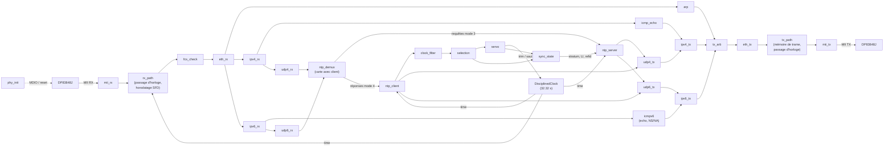

# glaucide-fpga-stratum2

Serveur NTP **stratum 2**, **IPv4 + IPv6**, entièrement en logique FPGA, sur **Digilent Arty A7-100T**
(`xc7a100tcsg324-1`, PHY TI DP83848J en MII 100 Mb/s). Le langage est
[TxHDL](https://github.com/filmil/hdl-txhdl) (HDL transactionnel embarqué en Rust, sortie Verilog),
épinglé au commit de `tools/setup.sh`.

Le FPGA est client NTP de serveurs de stratum 1 (jusqu'à 4, configurés à la synthèse) et sert ses
propres clients en UDP/123, avec des horodatages pris au niveau MAC (au SFD, sur le MII).

## État : simulé de bout en bout, jamais exécuté sur la carte

| Élément | État |
|---|---|
| Deux cartes (top-levels) générées en Verilog : `ArtyBoard` (serveur seul, stratum 16 faute de synchronisation) et `ArtyBoardWithClient` (stratum 2 après synchronisation) | fait, vérifié par `top_gen` |
| Simulation au cycle près, sur broches MII simulées à 25 MHz réels, avec les trames de référence | fait (`cargo test -p ntp_fpga`) |
| Modèles de référence Python (protocole, filtre, sélection, servo, client) | faits |
| Preuves formelles (SymbiYosys) | partielles : [docs/formal-report.md](docs/formal-report.md) |
| Synthèse, placement-routage, timing sous **Vivado** | **non faits** : le script `tools/vivado/build.tcl` n'a jamais été exécuté |
| Fonctionnement **sur la carte** (PHY, croisements d'horloge, précision mesurée) | **non vérifié** |

Limites de conception : configuration statique uniquement (pas de DHCP), pas d'authentification ni de NTS,
pas de mode symétrique ni broadcast, pas de mode 6/7 (`ntpq` ne peut pas interroger la carte), pas de
propagation de seconde intercalaire, pas de LED ni de sortie UART de diagnostic. Détail et chiffres
mesurés en simulation : [docs/status.md](docs/status.md).

## Architecture



Le chemin serveur (tout ce qui précède `tx_arb` sans `ntp_demux`, `ntp_client`, `clock_filter`,
`selection`, `servo`, `sync_state` branchés) est la carte `ArtyBoard` ; la carte `ArtyBoardWithClient`
ajoute le client, le démultiplexeur, le cache de voisins IPv6 (`nbr_cache`) et les arbitres UDP.
Le détail des unités est dans [docs/architecture.md](docs/architecture.md) et dans l'en-tête de
`rtl/src/top.rs` ; les horloges sont `clk_sys` 100 MHz (MMCM), et `clk_rx` / `clk_tx` 25 MHz fournies par le PHY.

## Démarrage rapide

Prérequis : `git`, une chaîne Rust (`cargo`), Python 3 ; voir [docs/user-guide.md](docs/user-guide.md).

```sh
tools/setup.sh                                # clone TxHDL au commit épinglé (third_party/hdl-txhdl)
cargo test -p ntp_fpga                        # suites Rust (longues en mode debug : plusieurs minutes)
python3 -m unittest discover tools/golden     # modèle de référence du protocole
cargo run -p ntp_fpga --bin top_gen           # écrit out/top/ (serveur seul)
cargo run -p ntp_fpga --bin top_gen -- --with-client   # variante stratum 2, même dossier
vivado -mode batch -source tools/vivado/build.tcl      # synthèse et bitstream : jamais exécuté, voir docs/bringup.md
```

Avant de construire pour un réseau réel, adaptez les adresses : [docs/config-guide.md](docs/config-guide.md).
Les valeurs par défaut (`config::Board`) sont des adresses de documentation (`192.0.2.0/24`,
`2001:db8::/32`) et des amonts fictifs.

## Plan du dépôt

| Chemin | Contenu |
|---|---|
| `rtl/src/` | crate Rust `ntp_fpga` : une unité TxHDL par fichier (`top.rs`, `top_client.rs`, `config.rs`, ...) |
| `rtl/src/bin/` | `top_gen` (Verilog de la carte), `gen_all` (un module), `formal_gen` (unités à prouver), `clock_sim` |
| `rtl/hdl/arty_top_board.v` | enveloppe de carte écrite à la main : MMCM, tampons d'horloge, séquence de reset, E/S du PHY |
| `rtl/tests/` | tests d'intégration et de système (simulation au cycle près) |
| `constraints/` | broches et délais d'E/S MII (`arty_a7_100.xdc`), notes de vérification |
| `tools/vivado/` | script de construction non interactif et contraintes de timing du top |
| `tools/golden/` | modèle de référence Python (protocole ; `ntpclient/` : filtre, sélection, servo, client) |
| `tools/formal/` | `prove.sh` (SymbiYosys), `contracts.py` (garanties/hypothèses) |
| `tools/setup.sh`, `tools/gen_verilog.sh`, `tools/estimate_resources.py` | clone de TxHDL, Verilog module par module, estimation de ressources |
| `tools/cargo/` | manifestes Cargo pointant vers les sources de TxHDL |
| `.github/workflows/` | CI : `ci.yml` (build, tests, Verilog), `formal.yml` (preuves) |
| `docs/` | documentation (ci-dessous) |

Cargo sert à simuler et à générer le Verilog. TxHDL amont utilise Bazel ; cette chaîne n'a pas été testée ici
(dépendance `filmil/bazel-rules-bid` bloquée par le proxy du conteneur où le projet a été écrit).

## Documentation

| Document | Contenu |
|---|---|
| [docs/user-guide.md](docs/user-guide.md) | prérequis, construction, choix de la carte, tests, preuves, table des modules |
| [docs/config-guide.md](docs/config-guide.md) | configurer adresses, amonts, limiteur de débit ; écrire son jeu de configuration |
| [docs/bringup.md](docs/bringup.md) | mise en service sur la carte, vérifications fonctionnelles, mesures, tableau de résultats |
| [docs/status.md](docs/status.md) | état, chiffres mesurés en simulation, limites, reste à faire |
| [docs/architecture.md](docs/architecture.md) | objectif, chaîne de données, décisions (statique, sans DHCP) |
| [docs/roadmap.md](docs/roadmap.md) | tâches par agent et leur état |
| [docs/formal.md](docs/formal.md), [docs/formal-report.md](docs/formal-report.md) | méthode et suivi des preuves formelles |
| [docs/resources.md](docs/resources.md) | estimation des ressources (Yosys, sans Vivado) |
| [docs/top-client-hooks.md](docs/top-client-hooks.md) | câblage du client dans le top stratum 2 |
| [docs/references.md](docs/references.md), [docs/questions.md](docs/questions.md) | projets de référence ; questions ouvertes |
| `docs/security.md` | revue de sécurité : à venir (T5.5) |
| `docs/timing.md` | revue de timing Vivado et CDC : à venir (T5.3) |

## Sécurité

N'exposez pas la carte à Internet avant la revue de sécurité (`docs/security.md`, à venir). Le serveur répond à
la source indiquée dans la requête (risque de réflexion) ; il borne l'effet (réponse de 48 octets au plus,
égale à la taille minimale d'une requête, limiteur de débit par source) mais cette borne n'a pas été revue.
Voir [docs/bringup.md](docs/bringup.md), section sécurité.

## CI

`ci.yml` (push, pull request) : `cargo build --workspace`, `cargo test -p ntp_fpga`, tests Python du modèle de
référence, génération Verilog ; `rustfmt` et `clippy` dans des jobs séparés, non bloquants. `formal.yml` (push
sur `main`, manuel, chaque nuit) : preuve non bornée de chaque unité de sa matrice ; tout résultat autre que PASS
fait échouer le job.
